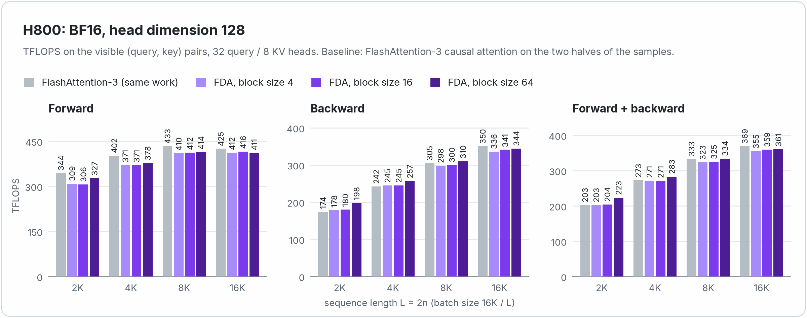
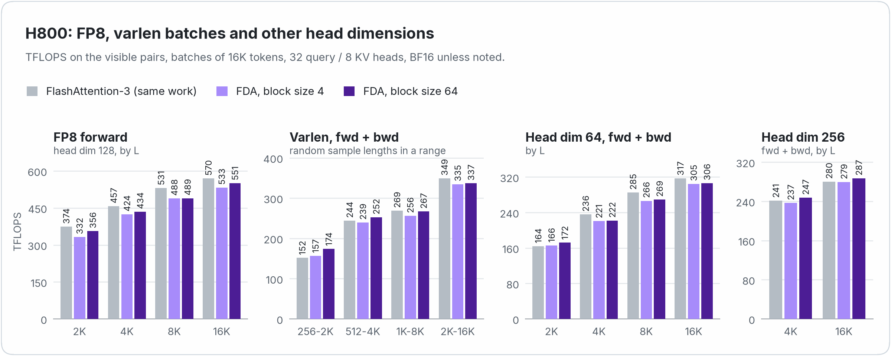
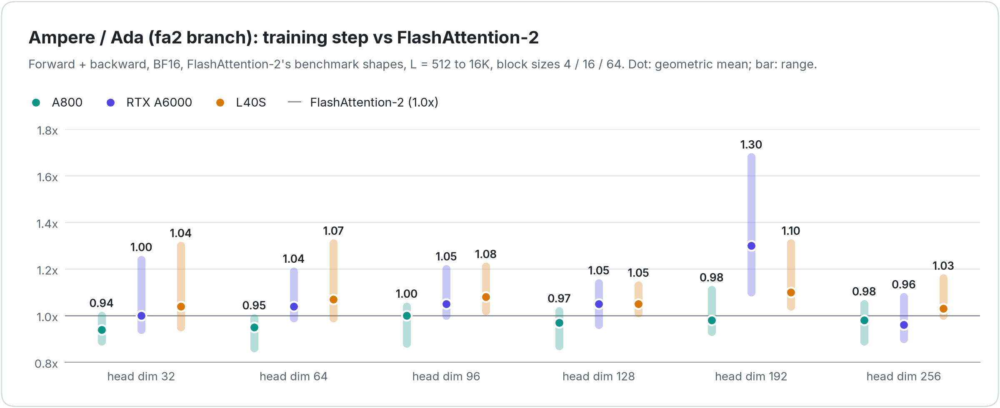

<div align="center">

# Fast Diffusion Attention

**FlashAttention-speed attention kernels for training block diffusion language models**

[](LICENSE)
[](#which-branch)
[](https://github.com/yuezhouhu/fast-diffusion-attention/tree/fa2)
[](https://pytorch.org)
[](https://developer.nvidia.com/cuda-toolkit)

[Performance](#performance) · [Installation](#installation) · [Quick start](#quick-start) · [Accuracy](#accuracy) ·
[How it works](#how-it-works) · [Blog post](docs/blog.md)

</div>

<p>
<picture>
  <source media="(prefers-color-scheme: dark)" srcset="assets/pattern_dark.png">
  
</picture>
</p>

Block diffusion language models ([BD3-LM](https://arxiv.org/abs/2503.09573), [SDAR](https://arxiv.org/abs/2510.06303),
[RCD](https://arxiv.org/abs/2601.22954), ...) are trained on the concatenation of a noisy copy and a clean copy of every
sequence, with the block-structured attention mask above. Fast Diffusion Attention computes this attention with kernels
derived from FlashAttention: the mask is never materialized, only the visible tiles of the attention matrix are
computed, and a training step runs at about the throughput of FlashAttention on the same amount of work.

- **FlashAttention speed.** A training step (forward + backward) runs at **0.96-1.10x** the throughput of
  FlashAttention-3 doing the same work on H800, and at 0.94-1.30x FlashAttention-2 on A800, RTX A6000 and L40S
  (geometric means per GPU and head dimension).
- **Only the visible quarter.** About 25% of the `2n x 2n` attention matrix is visible. Invisible tiles are never
  loaded or computed, and only the tiles that cross a block boundary are masked.
- **Complete.** Forward and backward in BF16 / FP16, FP8 forward on Hopper, any block size, head dimensions up to 256,
  MQA / GQA, varlen batches (packed samples), softcapping, dropout (Ampere / Ada), deterministic backward,
  `torch.compile`.
- **Tested like FlashAttention.** Errors within 2x those of PyTorch in the same precision, without bias, and matching
  FlashAttention's own errors on the causal sub-problem.
- **FlashAttention's interface.** `diffusion_attn_func` and `diffusion_attn_varlen_func` are modeled after
  `flash_attn_func` and `flash_attn_varlen_func`, with `block_size` in place of `causal`.

## Performance

### Hopper (H800)

The yardstick is FlashAttention-3 doing the same work: *causal* attention on the two halves of every sample (a batch
of `2B` sequences of length `n`), which has the same number of visible (query, key) pairs and the same tile structure
as the diffusion mask ([why](docs/blog.md#the-right-yardstick)). TFLOPS count only the visible pairs. H800 PCIe
(350 W), CUDA 13.0, PyTorch 2.12, FlashAttention-3 3.0.0.

<p>
<picture>
  <source media="(prefers-color-scheme: dark)" srcset="assets/perf_h800_bf16_dark.png">
  
</picture>
</p>

The backward pass, 75-80% of the attention time of a training step, runs at 0.95-1.18x the throughput of
FlashAttention-3 and the forward pass at 0.87-1.06x. A training step runs at **0.96-1.10x** FlashAttention-3 with BF16
and head dimension 128, and at 0.94-1.15x over all the configurations measured (varlen batches, head dimensions 64 and
256, blocks of 256 and 1024 tokens); the FP8 forward runs at 0.89-0.97x.

<p>
<picture>
  <source media="(prefers-color-scheme: dark)" srcset="assets/perf_h800_more_dark.png">
  
</picture>
</p>

Every measurement, with the times: [docs/performance.md](docs/performance.md).

### Ampere and Ada ([`fa2` branch](https://github.com/yuezhouhu/fast-diffusion-attention/tree/fa2))

<p>
<picture>
  <source media="(prefers-color-scheme: dark)" srcset="assets/perf_ampere_ada_dark.png">
  
</picture>
</p>

Against FlashAttention-2 on its own benchmark shapes (MHA with hidden size 2048, L = 512 ... 16K tokens), a training
step runs at 0.94-1.00x FlashAttention-2 on A800, 0.96-1.30x on RTX A6000 and 1.03-1.10x on L40S (geometric means per
head dimension). Every measurement:
[performance of the `fa2` branch](https://github.com/yuezhouhu/fast-diffusion-attention/blob/fa2/docs/performance.md).

## Which branch?

| | `main` (this branch) | [`fa2`](https://github.com/yuezhouhu/fast-diffusion-attention/tree/fa2) |
|---|---|---|
| GPUs | Hopper (sm90): H100, H800, H200, H20 | Ampere / Ada (sm80, sm86, sm89): A100, A800, A30, A10, A40, RTX A6000, L4, L40(S), RTX 30xx / 40xx |
| Kernels derived from | [FlashAttention-3](https://github.com/Dao-AILab/flash-attention/tree/main/hopper) | [FlashAttention-2](https://github.com/Dao-AILab/flash-attention/tree/main/csrc/flash_attn) |
| Training step vs FlashAttention | 0.96-1.10x FlashAttention-3 (H800) | 0.94-1.30x FlashAttention-2 (geometric means on A800, RTX A6000, L40S) |
| Data types | BF16 / FP16, FP8 forward | BF16 / FP16 |
| Dropout, packed QKV / KV functions | no | yes |
| Requirements | CUDA >= 12.3, PyTorch >= 2.4, Linux | CUDA >= 12, PyTorch >= 2.4, Linux |

## Installation

```bash
git clone --recursive https://github.com/yuezhouhu/fast-diffusion-attention.git
cd fast-diffusion-attention
pip install --no-build-isolation -v .
```

Requirements: a Hopper GPU (sm90), CUDA >= 12.3 (tested with 13.0), PyTorch >= 2.4 (tested with 2.12), Linux. For
Ampere and Ada GPUs, clone the `fa2` branch instead (`git clone --recursive -b fa2 ...`).

The full build compiles 50 kernel files (about 7 minutes on 20 cores with `MAX_JOBS=16`).

<details>
<summary>Build options: build only what you need</summary>

| Variable | Effect |
| --- | --- |
| `FDA_HDIMS="64 128"` | head dimensions to build (out of 64 96 128 192 256; a head dimension `d` uses the smallest kernel `>= d`) |
| `FDA_DISABLE_FP16=1` | no FP16 kernels (BF16 only) |
| `FDA_DISABLE_FP8=1` | no FP8 forward kernels |
| `FDA_DISABLE_SOFTCAP=1` | no softcapping kernels |
| `FDA_DISABLE_BACKWARD=1` | forward only |
| `MAX_JOBS`, `NVCC_THREADS` | parallelism of the build |

</details>

## Quick start

A sample of length `L = 2n` is laid out as `[noisy half (n tokens) | clean half (n tokens)]`, each half split into
blocks of `block_size` tokens (prompt tokens are blocks like any other).

```python
import torch
from fast_diffusion_attention import diffusion_attn_func

B, n, H, H_kv, D = 8, 1024, 32, 8, 128
# every sample: [noisy x_t (n tokens) | clean x_0 (n tokens)]
q = torch.randn(B, 2 * n, H, D, device="cuda", dtype=torch.bfloat16, requires_grad=True)
k = torch.randn(B, 2 * n, H_kv, D, device="cuda", dtype=torch.bfloat16, requires_grad=True)
v = torch.randn(B, 2 * n, H_kv, D, device="cuda", dtype=torch.bfloat16, requires_grad=True)

out = diffusion_attn_func(q, k, v, block_size=4)       # (B, 2n, H, D)
out.backward(torch.randn_like(out))
```

**Varlen (packed samples, e.g. SFT).** Sample `i` occupies rows `[cu_seqlens[i], cu_seqlens[i + 1])` and is laid out
as `[noisy (n_i) | clean (n_i)]`:

```python
from fast_diffusion_attention import diffusion_attn_varlen_func

ns = [300, 1000, 50]                                    # three samples of 2 * n_i tokens
cu_seqlens = torch.tensor([0, 600, 2600, 2700], device="cuda", dtype=torch.int32)
q = torch.randn(2 * sum(ns), H, D, device="cuda", dtype=torch.bfloat16, requires_grad=True)
k = torch.randn(2 * sum(ns), H_kv, D, device="cuda", dtype=torch.bfloat16, requires_grad=True)
v = torch.randn(2 * sum(ns), H_kv, D, device="cuda", dtype=torch.bfloat16, requires_grad=True)

out = diffusion_attn_varlen_func(q, k, v, cu_seqlens, cu_seqlens, max_seqlen_q=2000, max_seqlen_k=2000,
                                 block_size=4)          # (total, H, D)
```

**FP8 forward (inference).**

```python
q8, k8, v8 = (x.detach().to(torch.float8_e4m3fn) for x in (q, k, v))
descale = torch.ones(B, H_kv, device="cuda", dtype=torch.float32)   # per (sample, KV head)
out = diffusion_attn_func(q8, k8, v8, block_size=4, q_descale=descale, k_descale=descale, v_descale=descale)  # BF16
```

### API

```python
diffusion_attn_func(q, k, v, block_size, softmax_scale=None, q_descale=None, k_descale=None, v_descale=None,
                    softcap=0.0, deterministic=False, sm_margin=0, return_attn_probs=False)
diffusion_attn_varlen_func(q, k, v, cu_seqlens_q, cu_seqlens_k, max_seqlen_q, max_seqlen_k, block_size,
                           softmax_scale=None, q_descale=None, k_descale=None, v_descale=None,
                           softcap=0.0, deterministic=False, sm_margin=0, return_attn_probs=False)
```

| Argument | |
| --- | --- |
| `q`, `k`, `v` | `(batch, 2n, nheads, headdim)` / `(batch, 2n, nheads_kv, headdim)` (batched), `(total, nheads, headdim)` / `(total, nheads_kv, headdim)` (varlen). FP16, BF16 or `float8_e4m3fn` (forward only). `nheads` must be a multiple of `nheads_kv`; `headdim <= 256`, a multiple of 8 (16 for FP8). The last dimension must be contiguous. |
| `block_size` | size of the diffusion blocks, any positive integer |
| `cu_seqlens_q` | `(batch + 1,)` int32 cumulative sample lengths; every length is even (`2 n_i`). Self-attention only: `cu_seqlens_k` is `None` or equal to `cu_seqlens_q`, `max_seqlen_k` is `None` or equal to `max_seqlen_q` |
| `softmax_scale` | scale of `QK^T`, default `1 / sqrt(headdim)` |
| `q_descale`, `k_descale`, `v_descale` | `(batch, nheads_kv)` float32 descaling factors of FP8 inputs |
| `softcap` | `> 0` enables `softcap * tanh(scores / softcap)` |
| `deterministic` | bitwise reproducible backward (slightly slower) |
| `sm_margin` | number of SMs to leave free, e.g. for communication kernels |
| `return_attn_probs` | also return the log-sum-exp of the scores, `(batch, nheads, 2n)` or `(nheads, total)` |

The output has the shape and dtype of `q` (BF16 for FP8 inputs). Both functions are differentiable (FP16 / BF16) and
work with `torch.compile` (they are registered as custom ops with fake implementations). The mask is that of BD3-LM
(`block_diff_mask(..., use_regular_causal=False)` of SDAR-style training code, checked by
`tests/test_diffusion_attn.py::test_mask_matches_idlm`); `fast_diffusion_attention.reference` has a PyTorch reference
implementation.

## Accuracy

`tests/test_diffusion_attn.py` follows the methodology of the FlashAttention test suites:

- **Error bound.** For the output, the log-sum-exp and dQ / dK / dV, the error with respect to a float32 reference
  (computed from the same low-precision inputs) is at most twice the error of a straightforward PyTorch implementation
  in the same precision, plus a few ulps.
- **No systematic error.** Over many random problems, the relative bias and scale error of the output and of every
  gradient average to zero within 4 standard errors, and are no larger than twice those of PyTorch in the same
  precision (`test_no_systematic_error`).
- **The errors of FlashAttention-3.** With `block_size = 1` the clean half of a sample is causal attention: on this
  sub-problem the errors of the output, the LSE and dQ / dK / dV match those of FlashAttention-3 (the forward results
  are bitwise identical to FlashAttention-3's for most configurations; `test_accuracy_matches_fa3`).
- **FP8** as in FlashAttention-3: the error is at most twice that of a BF16 implementation that quantizes P to FP8
  like the kernel, without bias.
- **Reproducibility.** The deterministic mode is bitwise reproducible, and the varlen kernels are bitwise identical to
  the batched ones on equal-length samples.

The suite covers both dtypes, head dimensions 64-256 (including 80, 112, 160 and 224), block sizes from 1 to larger
than `n`, odd `n`, MQA / GQA, softcapping, varlen batches with very different and zero-length samples, non-contiguous
inputs, custom softmax scales, deterministic mode and `torch.compile`.

```bash
pytest tests/                               # 1100 tests pass on the full build (+20 skipped)
FDA_TEST_HDIMS=128 pytest tests/            # only the head dimensions that were built
```

## How it works

The kernels are those of FlashAttention-3 with the causal mask replaced by the diffusion mask. All the mask geometry
is in [`csrc/fda/diffusion.h`](csrc/fda/diffusion.h).

<p>
<picture>
  <source media="(prefers-color-scheme: dark)" srcset="assets/tiles_dark.png">
  
</picture>
</p>

- **Tiles.** The two halves of a sample are tiled separately. A query tile of the clean half visits the clean key tiles
  up to its own (like causal attention); a query tile of the noisy half visits the clean key tiles before its blocks
  and the noisy key tiles of its blocks. Only the partially visible tiles (those crossing a block boundary, at most a
  few per query tile) are masked, with large blocks too. In the backward pass, a key tile visits the query tiles of
  both halves that see it.
- **Forward.** Persistent warp-specialized kernel (a producer warpgroup issuing TMA loads, two consumer warpgroups
  running WGMMA with the softmax overlapped with the GEMMs), longest-processing-time-first scheduling across batches,
  heads and halves. When the block size divides 64, the noisy diagonal tile of a 128-row query tile is computed at
  half width (each consumer warpgroup only needs the 64 keys of its own rows). For head dimension 64 (and FP8 with
  head dimension 128) the tile size depends on the length of the halves.
- **Backward.** The main kernel follows FlashAttention-3 (one CTA per key tile and head, dQ accumulated in FP32 with
  TMA reduce-add, dK / dV of GQA heads summed in FP32). When the block size divides 64, the block-diagonal noisy-noisy
  part runs in a separate kernel that processes all the query heads of a KV head per tile, and the main kernel only
  iterates over the clean key tiles.
- **Varlen and determinism.** Samples are scheduled longest first, with per-sample offsets aligned to tiles in the
  FP32 accumulators. As in FlashAttention-3, the deterministic mode orders the dQ (and GQA dK / dV) accumulations with
  semaphores.

The [blog post](docs/blog.md) tells the whole story.

## Limitations

- Hopper (sm90a) only on this branch; Ampere and Ada GPUs: [`fa2` branch](https://github.com/yuezhouhu/fast-diffusion-attention/tree/fa2).
- Self-attention on `[noisy | clean]` samples with equal halves (`2n` tokens).
- No FP8 backward and no deterministic backward for head dimension 256 (as FlashAttention-3), no dropout.

## Citation

If you use Fast Diffusion Attention in your research, please cite it, and FlashAttention, from which the kernels are
derived ([citations](https://github.com/Dao-AILab/flash-attention#citation)):

```bibtex
@software{hu2026fastdiffusionattention,
  author = {Hu, Yuezhou and Keutzer, Kurt and Xu, Chenfeng},
  title  = {Fast Diffusion Attention: FlashAttention-class kernels for block diffusion language models},
  year   = {2026},
  url    = {https://github.com/yuezhouhu/fast-diffusion-attention}
}
```

## Acknowledgments and license

The CUDA kernels are derived from [FlashAttention](https://github.com/Dao-AILab/flash-attention) (FlashAttention-3 on
this branch, FlashAttention-2 on `fa2`) and built with [CUTLASS](https://github.com/NVIDIA/cutlass), both under the BSD
3-Clause license (see [NOTICE](NOTICE)). Fast Diffusion Attention is released under the [MIT license](LICENSE).
