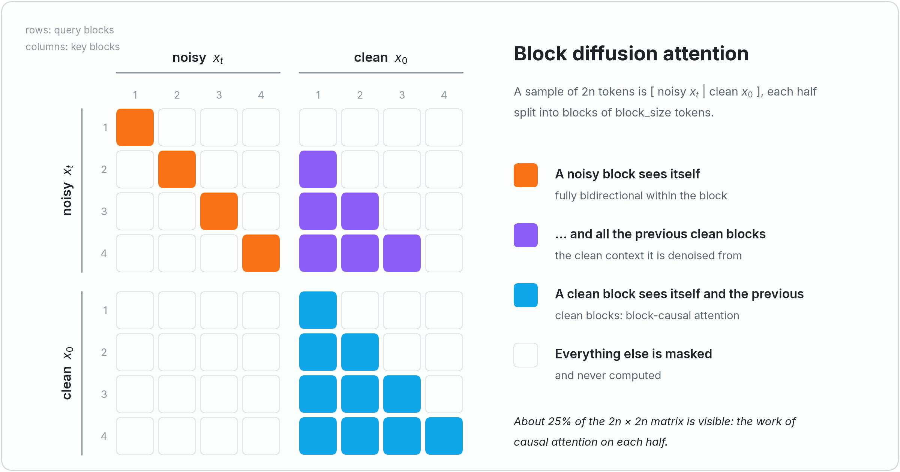
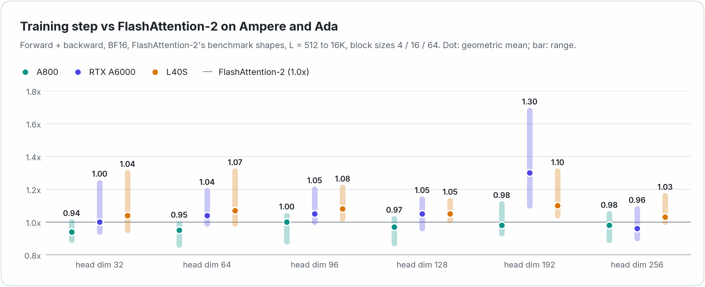
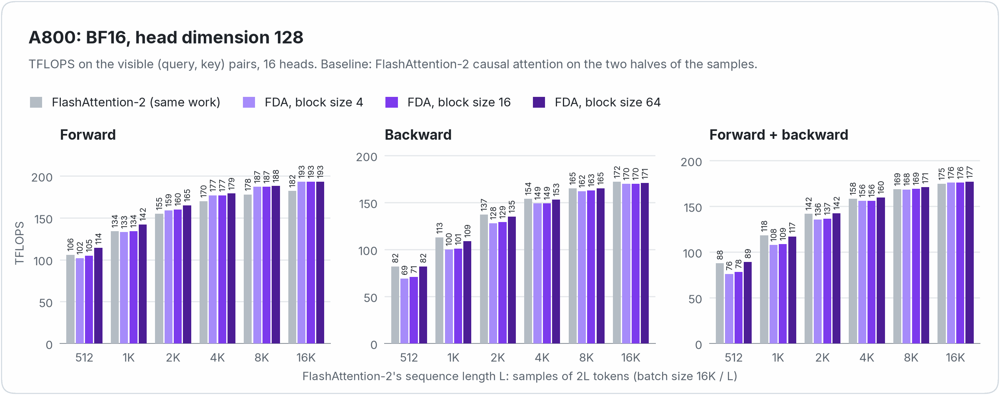
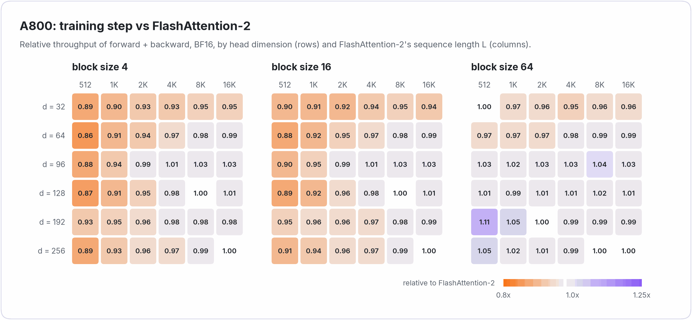
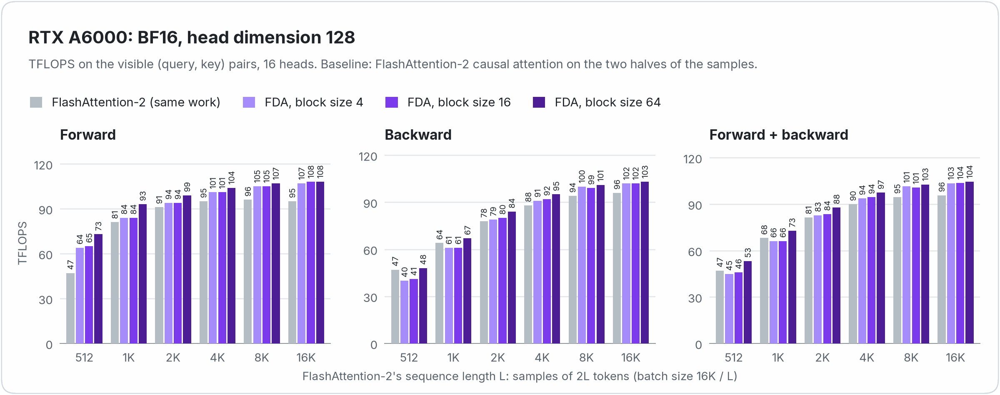
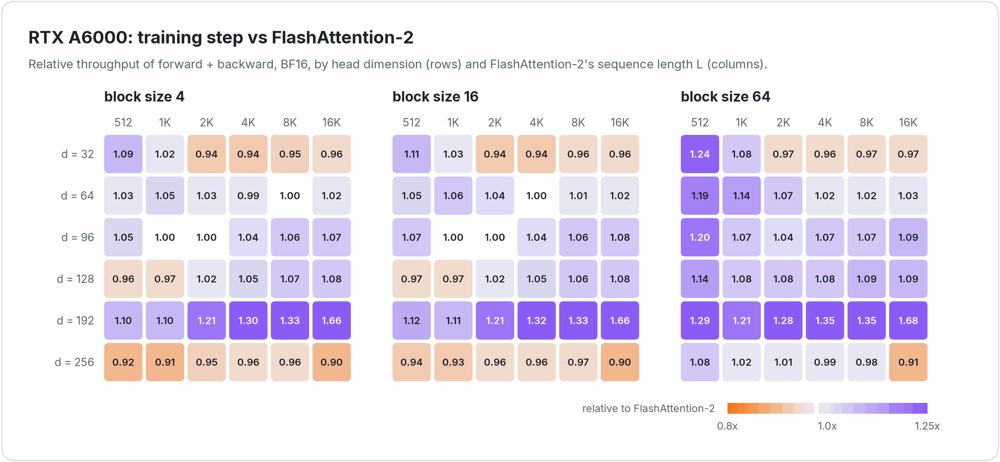
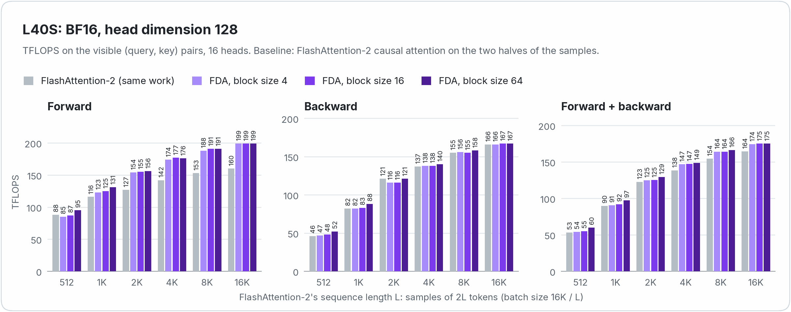
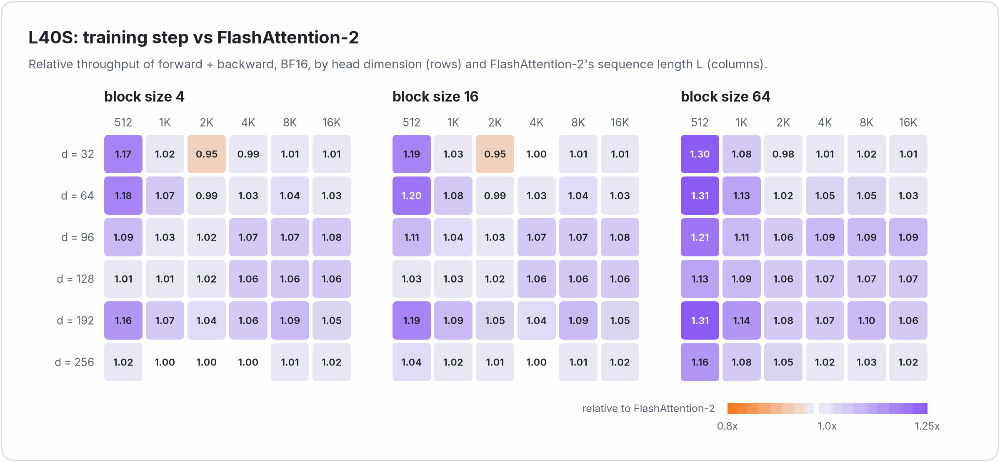
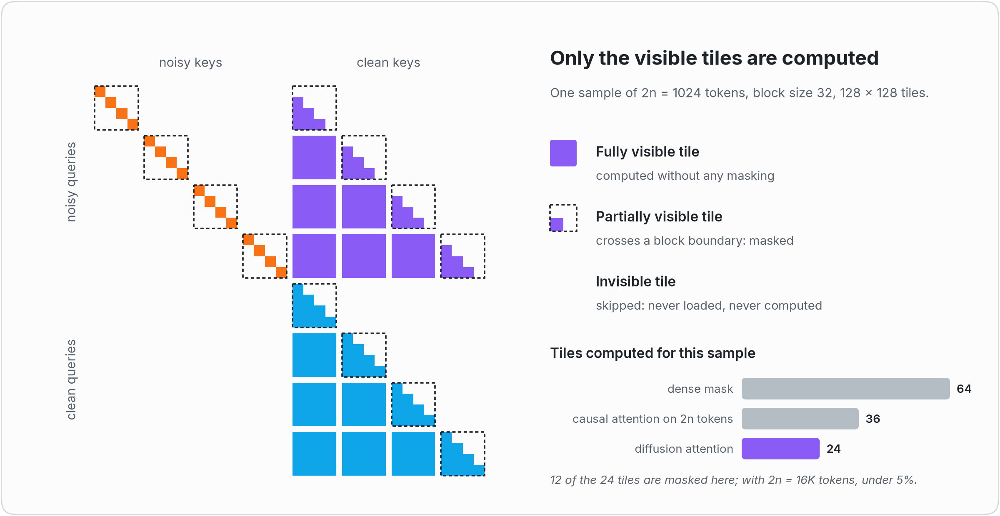

<div align="center">

# Fast Diffusion Attention

**FlashAttention-speed attention kernels for training block diffusion language models**

[](LICENSE)
[](#which-branch)
[](https://github.com/yuezhouhu/fast-diffusion-attention)
[](https://pytorch.org)
[](https://developer.nvidia.com/cuda-toolkit)

[Performance](#performance) · [Installation](#installation) · [Quick start](#quick-start) · [Accuracy](#accuracy) ·
[How it works](#how-it-works) · [Blog post](https://github.com/yuezhouhu/fast-diffusion-attention/blob/main/docs/blog.md)

</div>

> [!NOTE]
> This is the **`fa2` branch**: kernels for **Ampere and Ada GPUs** (sm80 / sm86 / sm89: A100, A800, A30, A10, A40,
> RTX A6000, L4, L40(S), RTX 30xx / 40xx), derived from FlashAttention-2. For Hopper GPUs (H100, H800, H200, H20), use
> the [`main` branch](https://github.com/yuezhouhu/fast-diffusion-attention) (FlashAttention-3 generation).

<p>
<picture>
  <source media="(prefers-color-scheme: dark)" srcset="assets/pattern_dark.png">
  
</picture>
</p>

Block diffusion language models ([BD3-LM](https://arxiv.org/abs/2503.09573), [SDAR](https://arxiv.org/abs/2510.06303),
[RCD](https://arxiv.org/abs/2601.22954), ...) are trained on the concatenation of a noisy copy and a clean copy of every
sequence, with the block-structured attention mask above. Fast Diffusion Attention computes this attention with kernels
derived from [FlashAttention-2](https://github.com/Dao-AILab/flash-attention/tree/main/csrc/flash_attn) (CUTLASS /
CuTe, `mma.sync`, `ldmatrix`, `cp.async`): the mask is never materialized, only the visible tiles of the attention
matrix are computed, and a training step runs at about the throughput of FlashAttention-2 on the same amount of work
or faster.

- **FlashAttention-2 speed.** A training step (forward + backward) runs at 0.94-1.00x the throughput of
  FlashAttention-2 doing the same work on A800, 0.96-1.30x on RTX A6000 and 1.03-1.10x on L40S (geometric means per
  head dimension).
- **Only the visible quarter.** About 25% of the `2n x 2n` attention matrix is visible. Invisible tiles are never
  loaded or computed, and only the tiles that cross a block boundary are masked.
- **Complete.** Forward and backward in BF16 / FP16 with the numerics of FlashAttention-2, any block size, head
  dimensions up to 256, MQA / GQA, varlen batches (packed samples), dropout, softcapping, deterministic backward,
  `torch.compile`.
- **Tuned per GPU class.** One kernel configuration per head dimension and GPU class (sm80, sm86, sm89), chosen over
  FlashAttention-2's search space (plus a few configurations of ours) on an A800, an RTX A6000 and an L40S.
- **FlashAttention-2's interface.** `diffusion_attn_func`, `diffusion_attn_varlen_func` and the packed variants are the
  functions of FlashAttention-2 with `block_size` in place of `causal` / `window_size` / `alibi_slopes`.

## Performance

The yardstick is FlashAttention-2 doing the same work: *causal* attention on the two halves of every sample, which has
the same number of visible (query, key) pairs and the same tile structure as the diffusion mask
([why](https://github.com/yuezhouhu/fast-diffusion-attention/blob/main/docs/blog.md#the-right-yardstick)), on
FlashAttention-2's benchmark shapes (MHA with hidden size 2048, L = 512 ... 16K tokens). TFLOPS count only the visible
pairs. CUDA 13.0, PyTorch 2.14, FlashAttention-2 2.8.4.

<p>
<picture>
  <source media="(prefers-color-scheme: dark)" srcset="assets/perf_summary_dark.png">
  
</picture>
</p>

<details>
<summary><b>A800</b>: TFLOPS with head dimension 128, and the training step for every head dimension</summary>

<p>
<picture>
  <source media="(prefers-color-scheme: dark)" srcset="assets/perf_a800_bf16_dark.png">
  
</picture>
</p>

<p>
<picture>
  <source media="(prefers-color-scheme: dark)" srcset="assets/perf_a800_hdims_dark.png">
  
</picture>
</p>

</details>

<details>
<summary><b>RTX A6000</b>: TFLOPS with head dimension 128, and the training step for every head dimension</summary>

<p>
<picture>
  <source media="(prefers-color-scheme: dark)" srcset="assets/perf_a6000_bf16_dark.png">
  
</picture>
</p>

<p>
<picture>
  <source media="(prefers-color-scheme: dark)" srcset="assets/perf_a6000_hdims_dark.png">
  
</picture>
</p>

</details>

<details>
<summary><b>L40S</b>: TFLOPS with head dimension 128, and the training step for every head dimension</summary>

<p>
<picture>
  <source media="(prefers-color-scheme: dark)" srcset="assets/perf_l40s_bf16_dark.png">
  
</picture>
</p>

<p>
<picture>
  <source media="(prefers-color-scheme: dark)" srcset="assets/perf_l40s_hdims_dark.png">
  
</picture>
</p>

</details>

With GQA (32 query / 8 KV heads, head dimension 128), the grouped backward brings the training step to 1.01x
FlashAttention-2 on A800, 1.06x on RTX A6000 and 1.10x on L40S (geometric means). Every measurement, with times, FP16,
GQA, varlen batches, dropout and the deterministic mode: [docs/performance.md](docs/performance.md).

## Which branch?

| | [`main`](https://github.com/yuezhouhu/fast-diffusion-attention) | `fa2` (this branch) |
|---|---|---|
| GPUs | Hopper (sm90): H100, H800, H200, H20 | Ampere / Ada (sm80, sm86, sm89): A100, A800, A30, A10, A40, RTX A6000, L4, L40(S), RTX 30xx / 40xx |
| Kernels derived from | [FlashAttention-3](https://github.com/Dao-AILab/flash-attention/tree/main/hopper) | [FlashAttention-2](https://github.com/Dao-AILab/flash-attention/tree/main/csrc/flash_attn) |
| Training step vs FlashAttention | 0.96-1.10x FlashAttention-3 (H800) | 0.94-1.30x FlashAttention-2 (geometric means on A800, RTX A6000, L40S) |
| Data types | BF16 / FP16, FP8 forward | BF16 / FP16 |
| Dropout, packed QKV / KV functions | no | yes |
| Requirements | CUDA >= 12.3, PyTorch >= 2.4, Linux | CUDA >= 12, PyTorch >= 2.4, Linux |

## Installation

```bash
git clone --recursive -b fa2 https://github.com/yuezhouhu/fast-diffusion-attention.git
cd fast-diffusion-attention
pip install --no-build-isolation -v .
```

Requirements: an Ampere or Ada GPU (compute capability 8.x), CUDA >= 12 (tested with 13.0), PyTorch >= 2.4 (tested
with 2.14), Linux. The CUTLASS submodule is the one of FlashAttention-2.

As FlashAttention-2, the build generates sm80 SASS (plus compute_80 PTX), which runs on every sm8x GPU. The full build
compiles 36 kernel files (about 2 minutes with `MAX_JOBS=36`).

<details>
<summary>Build options: build only what you need</summary>

| Variable | Effect |
| --- | --- |
| `FDA_HDIMS=64,128` | head dimensions to build (out of 32, 64, 96, 128, 192, 256; a head dimension `d` uses the smallest kernel `>= d`) |
| `FDA_DISABLE_FP16=1` | no FP16 kernels (BF16 only) |
| `FDA_DISABLE_DROPOUT=1` | no dropout kernels |
| `FDA_DISABLE_SOFTCAP=1` | no softcapping kernels |
| `FDA_DISABLE_BACKWARD=1` | forward only |
| `FDA_CUDA_ARCHS="80;86;89"` | additional SASS targets (default `80`) |
| `FDA_TUNING=1` | tuning build (see [tuning](docs/tuning.md#tuning)) |
| `MAX_JOBS`, `NVCC_THREADS` | parallelism of the build |

</details>

## Quick start

A sample of length `L = 2n` is laid out as `[noisy half (n tokens) | clean half (n tokens)]`, each half split into
blocks of `block_size` tokens (prompt tokens are blocks like any other).

```python
import torch
from fast_diffusion_attention import diffusion_attn_func

B, n, H, H_kv, D = 8, 1024, 32, 8, 128
# every sample: [noisy x_t (n tokens) | clean x_0 (n tokens)]
q = torch.randn(B, 2 * n, H, D, device="cuda", dtype=torch.bfloat16, requires_grad=True)
k = torch.randn(B, 2 * n, H_kv, D, device="cuda", dtype=torch.bfloat16, requires_grad=True)
v = torch.randn(B, 2 * n, H_kv, D, device="cuda", dtype=torch.bfloat16, requires_grad=True)

out = diffusion_attn_func(q, k, v, block_size=4)       # (B, 2n, H, D)
out.backward(torch.randn_like(out))
```

**Varlen (packed samples, e.g. SFT).** Sample `i` occupies rows `[cu_seqlens[i], cu_seqlens[i + 1])` and is laid out
as `[noisy (n_i) | clean (n_i)]`:

```python
from fast_diffusion_attention import diffusion_attn_varlen_func

ns = [300, 1000, 50]                                    # three samples of 2 * n_i tokens
cu_seqlens = torch.tensor([0, 600, 2600, 2700], device="cuda", dtype=torch.int32)
q = torch.randn(2 * sum(ns), H, D, device="cuda", dtype=torch.bfloat16, requires_grad=True)
k = torch.randn(2 * sum(ns), H_kv, D, device="cuda", dtype=torch.bfloat16, requires_grad=True)
v = torch.randn(2 * sum(ns), H_kv, D, device="cuda", dtype=torch.bfloat16, requires_grad=True)

out = diffusion_attn_varlen_func(q, k, v, cu_seqlens, cu_seqlens, max_seqlen_q=2000, max_seqlen_k=2000,
                                 block_size=4)          # (total, H, D)
```

### API

The functions of FlashAttention-2 with `causal` / `window_size` / `alibi_slopes` replaced by `block_size`:

```python
diffusion_attn_func(q, k, v, block_size, dropout_p=0.0, softmax_scale=None, softcap=0.0, deterministic=False,
                    return_attn_probs=False)
diffusion_attn_varlen_func(q, k, v, cu_seqlens_q, cu_seqlens_k, max_seqlen_q, max_seqlen_k, block_size,
                           dropout_p=0.0, softmax_scale=None, softcap=0.0, deterministic=False,
                           return_attn_probs=False)
diffusion_attn_qkvpacked_func(qkv, block_size, ...)            # qkv: (batch, 2n, 3, nheads, headdim)
diffusion_attn_kvpacked_func(q, kv, block_size, ...)           # kv: (batch, 2n, 2, nheads_kv, headdim)
diffusion_attn_varlen_qkvpacked_func(qkv, cu_seqlens, max_seqlen, block_size, ...)
diffusion_attn_varlen_kvpacked_func(q, kv, cu_seqlens_q, cu_seqlens_k, max_seqlen_q, max_seqlen_k, block_size, ...)
```

| Argument | |
| --- | --- |
| `q`, `k`, `v` | `(batch, 2n, nheads, headdim)` / `(batch, 2n, nheads_kv, headdim)` (batched), `(total, nheads, headdim)` / `(total, nheads_kv, headdim)` (varlen), FP16 or BF16. `nheads` must be a multiple of `nheads_kv`, `headdim <= 256` (padded to a multiple of 8 if needed). The last dimension must be contiguous. |
| `block_size` | size of the diffusion blocks, any positive integer |
| `cu_seqlens_q` | `(batch + 1,)` int32 cumulative sample lengths; every length is even (`2 n_i`). Self-attention only: `cu_seqlens_k` must equal `cu_seqlens_q` and `max_seqlen_k` must equal `max_seqlen_q` |
| `dropout_p` | dropout probability on the attention weights (as FlashAttention-2, set it to 0 for evaluation) |
| `softmax_scale` | scale of `QK^T`, default `1 / sqrt(headdim)` |
| `softcap` | `> 0` enables `softcap * tanh(scores / softcap)` |
| `deterministic` | bitwise reproducible backward (slightly slower, more memory) |
| `return_attn_probs` | also return `softmax_lse` (`(batch, nheads, 2n)` or `(nheads, total)`) and, with dropout, `S_dmask` (testing only, as in FlashAttention-2: `(batch, nheads, 2 hr, 2 hr)` with the clean half at row / column `hr = round_up(max n, 128)`, the dropped elements negative) |

The output has the shape and dtype of `q`. All the functions are differentiable and work with `torch.compile` (they
are registered as custom ops with fake implementations). The mask is that of BD3-LM
(`block_diff_mask(..., use_regular_causal=False)` of SDAR-style training code, checked by
`tests/test_diffusion_attn.py::test_mask_matches_idlm`); `fast_diffusion_attention.reference` has a PyTorch reference
implementation.

## Accuracy

`tests/test_diffusion_attn.py` follows the methodology of the FlashAttention-2 test suite:

- **Error bound.** For the output, the log-sum-exp and dQ / dK / dV, the error with respect to a float32 reference
  (computed from the same low-precision inputs) is at most twice the error of a straightforward PyTorch implementation
  in the same precision, plus a few ulps.
- **No systematic error.** Over many random problems, the relative bias and scale error of the output and of every
  gradient average to zero within 4 standard errors, and are no larger than twice those of PyTorch in the same
  precision (`test_no_systematic_error`).
- **The errors of FlashAttention-2.** With `block_size = 1` the clean half of a sample is causal attention: on this
  sub-problem the errors of the output, the LSE and dQ / dK / dV match those of FlashAttention-2
  (`test_accuracy_matches_fa2`).
- **Dropout** as in FlashAttention-2: the reference applies the dropout pattern returned in `S_dmask`.
- **Reproducibility.** The deterministic mode is bitwise reproducible, and the varlen kernels give the results of the
  batched ones on equal-length samples.

The suite covers both dtypes, all head dimensions (and padded ones: 40, 59, 80, 111, 160, 224), block sizes from 1 to
larger than `n`, odd `n`, MQA / GQA (with the GQA cases of the FlashAttention-3 tests, and the grouped backward
forced), dropout, softcapping, varlen batches with very different and zero-length samples, packed inputs,
non-contiguous inputs, custom softmax scales, deterministic mode, `torch.compile`, and the sequence lengths and block
sizes on both sides of every length-dependent kernel choice.

```bash
pytest tests/ -n 8                           # full build: 4509 tests pass (+172 skipped) on RTX A6000 and L40S
FDA_EMULATE_ARCH=86 pytest tests/ -n 8       # the kernels of sm86 GPUs (99 KB of shared memory) on an sm80 GPU
FDA_TEST_HDIMS=128 pytest tests/             # only the head dimensions that were built
```

`FDA_EMULATE_ARCH=86` / `89` makes the dispatch select the kernels that an sm86 / sm89 GPU would run (all of them fit
an sm80 GPU), so that their numerics are tested too. Natively, the suite passes on an RTX A6000 (sm86) and an L40S
(sm89): 4509 passed, 172 skipped; on an A800 (sm80): 4501 passed, 36 skipped, measured before the 144 dropout cases of
`test_long_sequence_tiles` were added (they run no other sm80 kernel).

## How it works

The kernels are those of FlashAttention-2 (`compute_attn_1rowblock`, `compute_dq_dk_dv_1colblock` with the
seqk-parallel backward) with the causal mask replaced by the diffusion mask. All the geometry is in
[`csrc/fda/src/diffusion.h`](csrc/fda/src/diffusion.h).

<p>
<picture>
  <source media="(prefers-color-scheme: dark)" srcset="assets/tiles_dark.png">
  
</picture>
</p>

- **Tiles.** The two halves of a sample are tiled separately. A query tile of the clean half visits the clean key
  tiles up to its own (like causal attention); a query tile of the noisy half visits the clean key tiles before its
  blocks and the noisy key tiles of its blocks. Only the partially visible tiles (those crossing a block boundary, a
  few per query tile) are masked, with any block size; they are visited first (as FlashAttention-2 visits its
  diagonal first), so that only they need predicated loads. In the backward pass, a key tile visits the query tiles of
  both halves that see it.
- **Forward.** When the scores of a tile take 64 registers per thread or more (head dimensions >= 64), the masked
  tiles are processed in two halves (two online-softmax updates on the same shared memory tile), which keeps the kernel
  below 255 registers without spills. With 128-row query tiles and block sizes dividing 16, each warp computes only
  the 16 keys of the noisy diagonal tiles that its rows can see (a quarter of the MMAs).
- **Backward.** FlashAttention-2's seqk-parallel kernel: one thread block per key tile and head, dQ accumulated in FP32
  with `atomicAdd` in a padded row layout where every half of every sample starts on a fresh tile. With MQA / GQA, a
  thread block processes its key tile for several query heads of the KV head and sums their dK / dV, iterating over
  the query tiles and, for each, over the heads, so that the thread blocks of a KV head read the same query tiles at
  the same time.
- **Block order.** Thread blocks run in groups of (batch, head) pairs of about 4 waves, the most expensive tiles of a
  group first; in the backward pass, the queries, output gradients and dQ accumulators of a group fit in twice the L2.
- **Dropout.** FlashAttention-2's Philox dropout on 16 x 32 blocks of the attention matrix, with the same pattern in
  the forward and the backward pass, for batched and varlen inputs.
- **Determinism.** As in FlashAttention-2, every thread block of a (batch, head) processes a fixed sequence of key
  tiles and accumulates their dQ in its own FP32 buffer; the buffers are summed in a fixed order.
- **Dispatch.** One tile configuration per head dimension, GPU class and dropout, in the format of FlashAttention-2's
  dispatch, tuned on an A800, an RTX A6000 and an L40S: see [dispatch and tuning](docs/tuning.md).

The [blog post](https://github.com/yuezhouhu/fast-diffusion-attention/blob/main/docs/blog.md) tells the whole story.

## Limitations

- sm80 / sm86 / sm89 (sm90 runs the sm80 kernels through PTX; use the
  [`main` branch](https://github.com/yuezhouhu/fast-diffusion-attention) there).
- One configuration per GPU class, each tuned on a single GPU: sm80 on A800, sm86 on RTX A6000, sm89 on L40S. Other
  GPUs of a class may prefer other configurations, sm89 especially: the RTX 4090 (128 SMs, 72 MB of L2) and the L4
  differ from the L40S (142 SMs, 96 MB). GeForce Ampere / Ada cards (RTX 3090 / 4090: half the FP16 / BF16 MMA rate
  with FP32 accumulation) are not tested.
- The backward of head dimension 192 with dropout on sm86 / sm89 keeps FlashAttention-2's configuration (the 32 x 64
  tiles cannot do dropout), which spills more in our kernel: 0.57-0.72x FlashAttention-2 on RTX A6000 (6 MB of L2),
  0.93-1.17x on L40S.
- The backward at short sequences with small blocks (4, 16): down to 0.83x FlashAttention-2 at L = 512 on A800 and
  RTX A6000 (the noisy diagonal key tiles are memory-bound); see [the measurements](docs/performance.md).
- Deterministic backward at L <= 1K on L40S: down to 0.64x FlashAttention-2's deterministic backward (a thread block
  covers both halves of a sample: twice the working set of FlashAttention-2's).
- The grouped GQA backward runs only without dropout and softcapping and not in deterministic mode (otherwise
  FlashAttention-2's dK / dV per query head); with little L2 (RTX A6000: 6 MB) it applies only to small head
  dimensions and short sequences.
- Self-attention on `[noisy | clean]` samples with equal halves (`2n` tokens).
- No FP8 (as FlashAttention-2).

## Citation

If you use Fast Diffusion Attention in your research, please cite it, and FlashAttention, from which the kernels are
derived ([citations](https://github.com/Dao-AILab/flash-attention#citation)):

```bibtex
@software{hu2026fastdiffusionattention,
  author = {Hu, Yuezhou and Keutzer, Kurt and Xu, Chenfeng},
  title  = {Fast Diffusion Attention: FlashAttention-class kernels for block diffusion language models},
  year   = {2026},
  url    = {https://github.com/yuezhouhu/fast-diffusion-attention}
}
```

## Acknowledgments and license

The CUDA kernels are derived from [FlashAttention](https://github.com/Dao-AILab/flash-attention) (FlashAttention-2 on
this branch, FlashAttention-3 on `main`) and built with [CUTLASS](https://github.com/NVIDIA/cutlass), both under the
BSD 3-Clause license (see [NOTICE](NOTICE)); the Python interface and the build script are adapted from
FlashAttention-2. Fast Diffusion Attention is released under the [MIT license](LICENSE).
