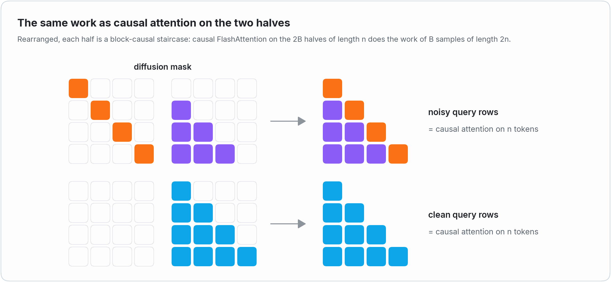

# Fast Diffusion Attention: block diffusion training at FlashAttention speed

*Yuezhou Hu, Kurt Keutzer, Chenfeng Xu · October 2026 · [Project page](https://yuezhouhu.github.io/projects/fast-diffusion-attention/) ·
[Code](https://github.com/yuezhouhu/fast-diffusion-attention) · [Performance data](performance.md)*

**TL;DR.** Block diffusion language models are trained on `[noisy | clean]` sequences with a block-structured attention
mask. Fast Diffusion Attention builds that mask into the FlashAttention kernels themselves: FlashAttention-3 on Hopper,
FlashAttention-2 on Ampere and Ada. Only the visible quarter of the attention matrix is computed, and a training step
runs at **0.96-1.10x the throughput of FlashAttention-3** doing the same work on H800 (and at 0.94-1.30x
FlashAttention-2 on A800, RTX A6000 and L40S), with the numerics of FlashAttention.

```python
from fast_diffusion_attention import diffusion_attn_func

out = diffusion_attn_func(q, k, v, block_size=4)   # q, k, v: (batch, 2n, heads, headdim), [noisy | clean]
```

## Block diffusion in one picture

Block diffusion language models such as [BD3-LM](https://github.com/kuleshov-group/bd3lms),
[SDAR](https://github.com/JetAstra/SDAR), [RCD](https://github.com/yuezhouhu/residual-context-diffusion) and
[ORL](https://github.com/Introspective-Diffusion/ORL) sit between autoregressive and diffusion models: they generate a
sequence block by block, autoregressively, and denoise the tokens of each block in parallel, diffusion style. Training
follows the same structure. BD3-LM computes the loss of all the blocks "in one forward pass on the concatenation
x_noisy ⊕ x" of the noisy and the clean sequence ([paper](https://arxiv.org/abs/2503.09573)), so that each noisy block
can be denoised from the clean blocks before it. The attention mask that makes this work:

<p>
<picture>
  <source media="(prefers-color-scheme: dark)" srcset="../assets/pattern_dark.png">
  
</picture>
</p>

A noisy block sees itself, bidirectionally, and all the previous clean blocks: the context it is denoised from. A clean
block sees itself and the previous clean blocks: block-causal attention, which computes the keys and values that the
next noisy blocks attend to, exactly as a KV cache would during generation. Every other pair is masked.

## Why a dedicated kernel

The concatenation turns every training sample of `n` tokens into a sequence of `2n` tokens, and its attention matrix
into a `2n x 2n` matrix of which only about a quarter is visible. Implementations usually hand this mask to a
general-purpose path: a dense boolean mask for PyTorch's `scaled_dot_product_attention`, which computes all the `4n^2`
scores (four times the visible work), or a block mask for FlexAttention, which BD3-LM uses.

We wanted the throughput of FlashAttention itself, on the GPUs where FlashAttention-3 runs (Hopper) and on those where
FlashAttention-2 is the state of the art (Ampere and Ada). So instead of expressing the mask on top of a generic kernel,
we built it into FlashAttention's kernels.

## The right yardstick

How fast can attention with this mask possibly be? Rearrange the visible blocks of every row, and each half of the
matrix becomes a block-causal staircase: row `i` of the noisy half sees the `i - 1` clean blocks before it and its own
noisy block, `i` blocks in total, exactly like row `i` of a causal mask over blocks.

<p>
<picture>
  <source media="(prefers-color-scheme: dark)" srcset="../assets/equal_work_dark.png">
  
</picture>
</p>

So `B` diffusion samples of length `2n` contain the visible (query, key) pairs of causal attention on `2B` sequences of
length `n`, with the same tile structure. Up to the diagonal blocks, which are full squares instead of triangles,
the counts are equal: `n^2 + n * block_size` against `n^2 + n` per sample. This gives a precise yardstick: FlashAttention
running causal attention on the `2B` halves, the same work done by the reference attention kernel.

Throughout, TFLOPS count only the visible pairs (`4 * pairs * headdim * nheads` for the forward pass, 2.5x that for the
backward pass, as in FlashAttention's benchmarks). A relative throughput of 1.0 means that the diffusion kernel is
exactly as efficient as FlashAttention's causal kernel. Comparing against causal attention on all the `2n` tokens
would make the diffusion kernels look twice as fast, since it does twice the work; we do not.

## How the kernels work

### Visit only the visible tiles

FlashAttention computes attention one tile at a time: a block of query rows against a block of keys, for example
128 x 128. The diffusion kernels enumerate, for every query tile, exactly the key tiles that intersect the mask (and in
the backward pass, for every key tile, exactly the query tiles that see it). The two halves of a sample are tiled
separately, so that a tile never straddles the noisy and the clean half:

- a query tile of the clean half visits the clean key tiles up to its own, like causal attention;
- a query tile of the noisy half visits the clean key tiles before its blocks and the noisy key tiles of its blocks.

Tiles inside the visible region run without any masking; only the tiles that cross a block boundary, at most a few per
query tile, apply the mask element by element. Invisible tiles are never loaded.

<p>
<picture>
  <source media="(prefers-color-scheme: dark)" srcset="../assets/tiles_dark.png">
  
</picture>
</p>

All the geometry lives in one header, [`diffusion.h`](../csrc/fda/diffusion.h): the offsets of the halves (for batched
and varlen inputs), the visible key and query intervals, the tile enumerations of the forward and backward passes, and
the per-element mask. The kernels themselves keep FlashAttention's structure, with the causal loop bounds replaced by
these enumerations.

The only work beyond causal attention on the halves is the noisy diagonal: a noisy query tile visits one more key tile
than a causal one, about 5% more work at 2K tokens and 1% at 16K. The rest of the engineering is about making every
visited tile run at FlashAttention's speed.

### Hopper: the FlashAttention-3 generation

The `main` branch keeps the architecture of FlashAttention-3: persistent, warp-specialized kernels in which a producer
warpgroup issues TMA loads and two consumer warpgroups run WGMMA, with the softmax of one tile overlapped with the
matrix multiplications of the next. On top of the tile enumeration:

- **Half-width noisy diagonal.** When the block size divides 64, each consumer warpgroup of a 128-row query tile only
  sees the 64 keys of its own rows on the noisy diagonal, so the diagonal tile is computed at half width.
- **A dedicated kernel for the noisy diagonal of the backward pass.** When the block size divides 64, the block-diagonal
  noisy-noisy part of the backward pass runs in a separate kernel that processes all the query heads of a KV head per
  tile (pipelined with `cp.async`). It writes the initial dQ of the noisy queries and the complete dK / dV of the noisy
  keys, and the main backward kernel only iterates over the clean key tiles.
- **Scheduling.** The persistent scheduler hands out the tiles of all the batches, heads and halves longest first. For
  head dimension 64 (and FP8 with head dimension 128) the tile size depends on the length of the halves: smaller tiles
  for short halves, where the fixed cost of the noisy diagonal per query tile matters, and FlashAttention-3's larger
  tiles for long ones.
- **Registers.** The consumer warpgroups of the main kernels are kept free of register spills: a spill in the backward
  hot loop costs about 10%. The backward pass masks with a condition inside a single loop rather than in a separate
  loop, and the register split between the producer and the consumer warpgroups (24 / 240, or 40 / 232 for the varlen
  kernels) was chosen by A/B timings against FlashAttention-3.

Varlen batches (packed samples of different lengths, as in SFT) schedule the samples longest first and align every
half of every sample to a tile in the FP32 accumulators of the backward pass. The deterministic mode orders the
accumulations of dQ (and of dK / dV with GQA) with semaphores, as FlashAttention-3 does.

### Ampere and Ada: the FlashAttention-2 generation

The [`fa2` branch](https://github.com/yuezhouhu/fast-diffusion-attention/tree/fa2) starts from the kernels of
FlashAttention-2 2.8 (`mma.sync`, `ldmatrix`, `cp.async`), where register pressure decides the speed:

- **Masked tiles first.** As FlashAttention-2 visits its diagonal first, the diffusion kernels visit the masked tiles
  first, so that only they need predicated loads. When the scores of a tile take 64 registers per thread or more (head
  dimensions >= 64), the masked tiles are processed in two halves, two online-softmax updates on the same tile in shared
  memory, which keeps the kernel below 255 registers without spills.
- **Diagonal sub-tiles.** With 128-row query tiles and block sizes dividing 16, each warp computes only the 16 keys of
  the noisy diagonal that its rows can see: a quarter of the MMAs.
- **GQA-grouped backward.** A thread block sums the dK / dV of several query heads of a KV head, so that its key tile is
  loaded once for all of them. At 512-1K tokens per half, the backward pass gets 8.3% (A800), 6.5% (L40S) and 2.8%
  (RTX A6000) faster on average, up to 23%.
- **L2-aware block order.** Thread blocks run in groups of (batch, head) pairs of about four waves, the most expensive
  tiles first, and the backward groups keep their queries, output gradients and dQ accumulators within twice the L2:
  up to 23% faster for short sequences.
- **Dispatch tuned per GPU class.** Following FlashAttention-2's workflow, every configuration of its launch templates
  (19 forward, 25 backward, plus 9 backward configurations of ours) was measured on its benchmark shapes on an A800
  (sm80), an RTX A6000 (sm86) and an L40S (sm89). A configuration replaces FlashAttention-2's only where it is at
  least 3% faster. For example, the backward pass of head dimension 192 on RTX A6000 went from 0.6-0.8x to 1.1-1.4x
  the throughput of FlashAttention-2.

### Measuring on power-capped GPUs

All the development GPUs are power-capped PCIe cards whose clock follows the power draw, and FlashAttention's own times
move by a few percent between runs. So every comparison is measured in interleaved rounds within one process, the
diffusion kernel and FlashAttention back to back, and the medians are reported; on Ampere and Ada, every measurement
also runs for about 300 ms after a warm-up of the same length, so that the clock reaches its steady state.

## Results

On H800, with BF16 and head dimension 128, the forward pass reaches 0.89-0.98x the throughput of FlashAttention-3, the
backward pass, 75-80% of the attention time of a training step, 0.96-1.14x, and a training step 0.96-1.10x:

<p>
<picture>
  <source media="(prefers-color-scheme: dark)" srcset="../assets/perf_h800_bf16_dark.png">
  
</picture>
</p>

The FP8 forward pass runs at 0.89-0.97x FlashAttention-3 (up to 551 TFLOPS), varlen batches of samples of random
lengths at 0.95-1.15x for a training step, and head dimensions 64 and 256 at 0.94-1.05x:

<p>
<picture>
  <source media="(prefers-color-scheme: dark)" srcset="../assets/perf_h800_more_dark.png">
  
</picture>
</p>

On Ampere and Ada, against FlashAttention-2 on its benchmark shapes, a training step runs at 0.94-1.00x on A800,
0.96-1.30x on RTX A6000 and 1.03-1.10x on L40S (geometric means per head dimension):

<p>
<picture>
  <source media="(prefers-color-scheme: dark)" srcset="../assets/perf_ampere_ada_dark.png">
  
</picture>
</p>

Every measurement, with times, block sizes up to 1024, dropout and the deterministic mode, is in the performance pages
of [`main`](performance.md) and [`fa2`](https://github.com/yuezhouhu/fast-diffusion-attention/blob/fa2/docs/performance.md).

## Accuracy

Fast kernels are only useful if they are right. The test suites follow the methodology of FlashAttention: for the
output, the log-sum-exp and dQ / dK / dV, the error with respect to a float32 reference (computed from the same
low-precision inputs) must be at most twice the error of a straightforward PyTorch implementation in the same
precision. Two further checks go beyond the maximum error:

- **No systematic error.** Over many random problems, the relative bias and the relative scale error of the output and
  of every gradient average to zero within 4 standard errors, and are no larger than twice those of PyTorch.
- **FlashAttention's own errors.** With `block_size = 1`, the clean half of a sample is causal attention on the clean
  tokens. On this sub-problem the errors of the diffusion kernels must match those of FlashAttention-3 (respectively
  FlashAttention-2); the forward results of the Hopper kernels are bitwise identical to FlashAttention-3's for most
  configurations.

The deterministic mode is bitwise reproducible, the varlen kernels agree with the batched ones, and the suites (1100
tests on `main`, 4500 on `fa2`) cover block sizes from 1 to longer than the halves, odd lengths, MQA / GQA, softcapping,
dropout, varlen batches with zero-length samples, non-contiguous inputs and `torch.compile`.

## Try it

```bash
# Hopper (H100, H800, H200, H20)
git clone --recursive https://github.com/yuezhouhu/fast-diffusion-attention.git
# Ampere and Ada (A100, A800, A6000, L40S, RTX 30xx / 40xx, ...)
git clone --recursive -b fa2 https://github.com/yuezhouhu/fast-diffusion-attention.git

cd fast-diffusion-attention && pip install --no-build-isolation -v .
```

`diffusion_attn_func` and `diffusion_attn_varlen_func` are modeled after `flash_attn_func` and
`flash_attn_varlen_func`, with `block_size` in place of `causal`: in a block diffusion model, they replace the attention
over the concatenated `[noisy | clean]` sequence. The [README](../README.md) has the full API.

## Acknowledgments

Fast Diffusion Attention stands on [FlashAttention](https://github.com/Dao-AILab/flash-attention) (Tri Dao and
contributors) and [CUTLASS](https://github.com/NVIDIA/cutlass): the kernels are theirs, with the diffusion mask built
in. The mask is that of [BD3-LM](https://arxiv.org/abs/2503.09573), and the equivalence with the masks of SDAR-style
training code is checked by the test suite.
